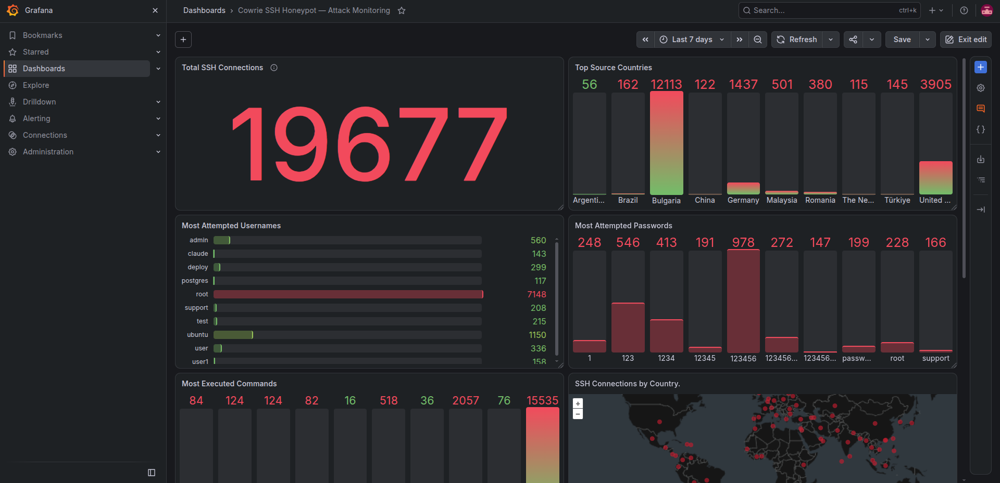
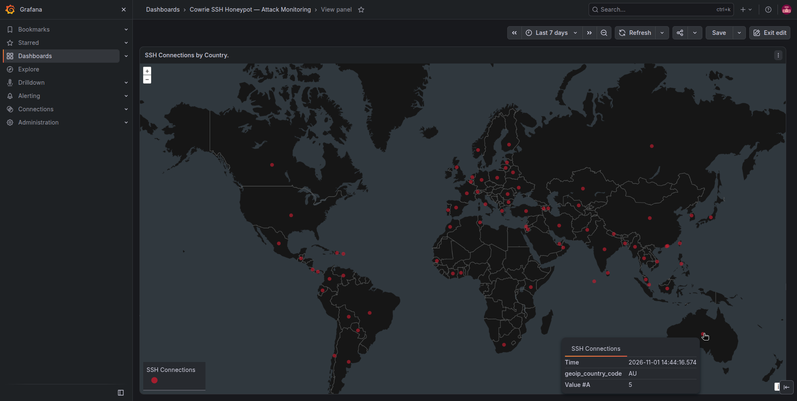
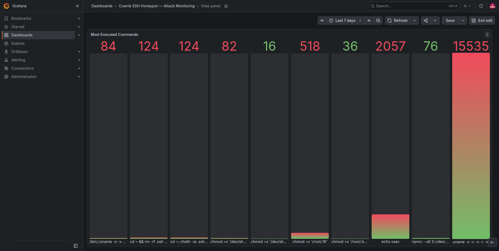

# Cowrie SSH Honeypot & Attack Monitoring Dashboard

## Project Overview

This project involved deploying an internet-facing SSH honeypot on an Oracle Cloud VPS to observe and analyze real-world SSH attacks.

The honeypot was built using Cowrie, an open-source SSH/Telnet honeypot that simulates an interactive Linux environment. It allows attackers to attempt authentication and execute commands inside an emulated shell without granting access to the underlying operating system.

To monitor the activity, I implemented a centralized logging pipeline using Grafana Alloy, Loki, and Grafana. I also integrated GeoLite2 geolocation data to visualize the geographic distribution of incoming SSH connections.

The honeypot was exposed to the internet for approximately five calendar days, from October 28 to November 1, 2026.

During this observation period, the system recorded:

- 19,652 SSH connections
- 573 unique source IP addresses
- 27,204 commands entered into the honeypot
- 163,513 total logged events

The project provided hands-on experience with Linux server administration, Docker networking, firewall configuration, centralized logging, threat monitoring, and security analysis.

## Project Objectives

The main objectives were to:

1. Deploy an internet-facing SSH honeypot in a cloud environment.
2. Capture authentication attempts and attacker interactions.
3. Isolate the honeypot from the underlying host and monitoring services.
4. Collect and centralize security logs using Grafana Alloy and Loki.
5. Develop an interactive Grafana dashboard to visualize SSH activity.
6. Enrich source IP addresses with geographic information.
7. Analyze observed attacker behavior and document the findings.

## Technology Stack

| Technology | Purpose |
|------------|---------|
| Oracle Cloud Infrastructure | Cloud VPS hosting |
| Ubuntu Server 24.04 LTS | Host operating system |
| Docker and Docker Compose | Container deployment and management |
| Cowrie | SSH honeypot and attacker interaction logging |
| Grafana Alloy | Log collection and processing |
| Grafana Loki | Centralized log storage |
| Grafana | Security monitoring dashboard |
| MaxMind GeoLite2 | IP geolocation enrichment |
| UFW / iptables | Firewall rules and network isolation |
| Python | Offline log analysis |

## Observation Period

- **Start:** October 28, 2026, 00:20 UTC
- **End:** November 1, 2026, 14:21 UTC
- **Initial testing excluded:** October 27, 2026

The initial testing day was excluded from the final statistics to reduce contamination from deployment and validation activities.

The remaining results represent recorded honeypot activity, although some subsequent test events may still be present.

## Results at a Glance

| Metric | Value |
|:-------|------:|
| Logged events | 163,513 |
| SSH connections | 19,652 |
| Unique source IPs | 573 |
| Commands recorded | 27,204 |
| Simulated successful logins | 18,901 |

The observation period covers October 28–November 1, 2026.
Initial testing on October 27 was excluded.
Some later testing may still be present in the data.

## Architecture

The project uses Cowrie, Grafana Alloy, Loki,
and Grafana on an Oracle Cloud VPS.

See [System Architecture](docs/architecture.md) for the
architecture diagram, logging pipeline, and network design.

## Dashboard

## Dashboard

The Grafana dashboard was developed to monitor incoming SSH
activity and provide visibility into attacker interactions.

### Monitoring Overview

### Geographic Activity

### Recorded Commands

The dashboard visualizes SSH connection activity, attempted
credentials, recorded commands, and approximate geographic
distributions of source IP addresses.

## Documentation

- [System Architecture](docs/architecture.md)
- [Security Measures](docs/security.md)
- [Challenges and Lessons Learned](docs/troubleshooting.md)
- [Attack Findings](docs/findings.md)

## Analysis

The Python script used to summarize Cowrie JSON events
is available at [scripts/analyze.py](scripts/analyze.py).

Raw attack logs and captured credentials are not published.
