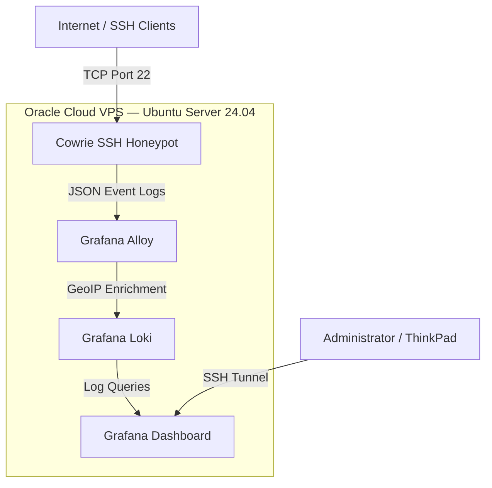

## System Architecture

The project was deployed on an Oracle Cloud Infrastructure (OCI) virtual machine running Ubuntu Server 24.04 LTS.

Docker Compose was used to manage four main services: Cowrie, Grafana Alloy, Grafana Loki, and Grafana.

### Architecture Diagram

### Component Responsibilities

**Cowrie SSH Honeypot**

Cowrie was configured as an internet-facing SSH honeypot. Incoming connections were directed to the Cowrie container, which simulated an interactive Linux shell and recorded authentication attempts, executed commands, and session activity.

**Grafana Alloy**

Alloy collected Cowrie's structured JSON logs and forwarded them to Loki. It also enriched source IP addresses with country information using a MaxMind GeoLite2 database.

**Grafana Loki**

Loki provided centralized storage and querying of the collected events. LogQL queries were used to extract information about SSH connections, attempted credentials, executed commands, and geographic activity.

**Grafana**

Grafana was used to create an interactive security monitoring dashboard. The dashboard displayed connection statistics, activity trends, commonly attempted credentials, executed commands, top source IPs, and geographic distributions.

### Network Architecture

The deployment used separate Docker networks for the publicly accessible honeypot and the internal monitoring services.

- **Port 22:** Publicly accessible SSH honeypot.
- **Port 22222:** Administrative SSH access, restricted to approved source IP addresses and authenticated using SSH keys.
- **Port 3000:** Grafana, bound to localhost and accessed through an encrypted SSH tunnel.
- **Port 3100:** Loki, bound to localhost rather than exposed publicly.

This design helped separate attacker-facing services from the management and monitoring infrastructure.
